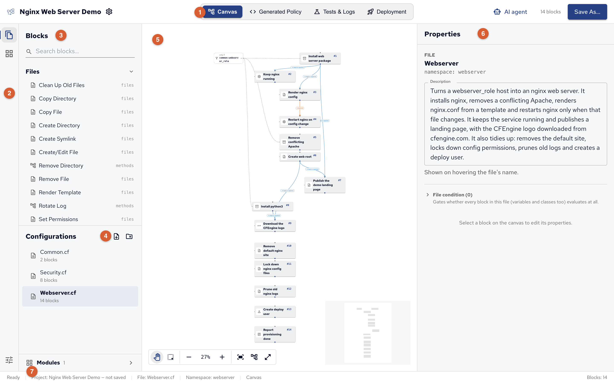

Policy Builder is a desktop application for writing CFEngine policy without writing the policy language by hand.
You describe the state you want your hosts in, such as a package installed, a file with certain content or a service running, by placing blocks on a canvas and connecting them.
Policy Builder turns them into CFEngine policy, checks it, tests it on containers on your own computer and deploys it to your CFEngine hub.

## How Policy Builder works

You build policy from ready-made pieces, each one thing a host should have or do: install a package, write a file, keep a service running.
You fill in the details, such as which package or what the file contains, put the pieces in the order they should happen, and say which hosts they're for.
Policy Builder writes the CFEngine policy for you, and you can read every line of it, which is also a good way to learn the policy language.

From there, it follows the policy all the way to your hosts:

1. **Build**: assemble the policy in a project, a folder on your computer.
2. **Test**: run it on containers on your own computer, and see what it changed.
3. **Deploy**: send it to your CFEngine hub, where every host fetches it.

[The demo project][] is a complete project to explore, ready to test. See [Promises][] for the CFEngine idea behind each piece.

## The window

1. **Top bar**: the project's name and settings, and its four views: **Canvas**, where you build; **Generated Policy**, the policy the blocks become; **Tests & Logs**, test runs on containers; **Deployment**, getting the policy to your hub. On the right, **AI agent** and **Save**.
2. **Activity bar**: switches the side bar between **Blocks and files** and **Modules**; **Project settings** at the bottom.
3. **Blocks**: every block, by category, with search. The tag on the right of each block, such as `files`, is the CFEngine promise type it generates.
4. **Configurations**: the project's policy files. Click one to open it on the canvas.
5. **Canvas**: the open configuration's blocks and arrows, numbered in run order, with the zoom, Tidy up and full screen tools at the bottom.
6. **Properties**: the selected block's settings, or the open configuration's when nothing is selected.
7. **Status bar**: what Policy Builder is doing, the project, the open file and its namespace.

Keyboard shortcuts in these pages are written for macOS, with ⌘ (Command), ⇧ (Shift) and ⌥ (Option); on Windows and Linux, use Ctrl for ⌘ and Alt for ⌥.
**Help**, then **Keyboard Shortcuts** lists them all.

## What you need

- **Policy Builder** on your computer: see [Installing Policy Builder][].
- **A CFEngine hub, with hosts bootstrapped to it**, to deploy to: the hub is the policy server your hosts fetch their policy from, and a host joins it by bootstrapping to it when CFEngine is installed. Community and Enterprise hubs both work; see [Installing CFEngine][]. You can build and test policy without one.
- **CFEngine 3.27 or later** on the hub and hosts: the generated policy relies on promises running in the order they're written, which is new in 3.27.
- **CFEngine Enterprise** for Mission Portal and for deploying through a git repository the hub pulls. A Community hub is deployed to over SSH instead.

## In this section

1. [Installing Policy Builder][]
2. [Policy Builder projects][]: what a project is, creating, opening and saving one
3. [Building policy on the canvas][]: blocks, arrows, conditions, groups and configurations
4. [Generated policy][]: what Policy Builder writes, and how to read it
5. [Values and templates][]: variables, classes, lists and data, and templates
6. [Modules in Policy Builder][]: CFEngine Build modules
7. [Test environments][]: running the policy on containers before it reaches real hosts
8. [Deploying from Policy Builder][]: to a hub, through git or over SSH
9. [AI agents in Policy Builder][]: letting an AI agent build with you
10. [The demo project][]: a complete project to explore, using everything above
11. [Block reference][]: every block, its settings and the policy it generates, and [Custom CFEngine and Call Method][] for what no block does
