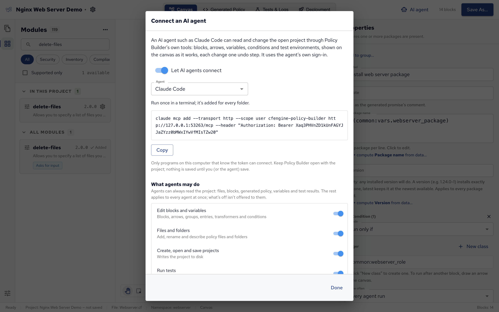
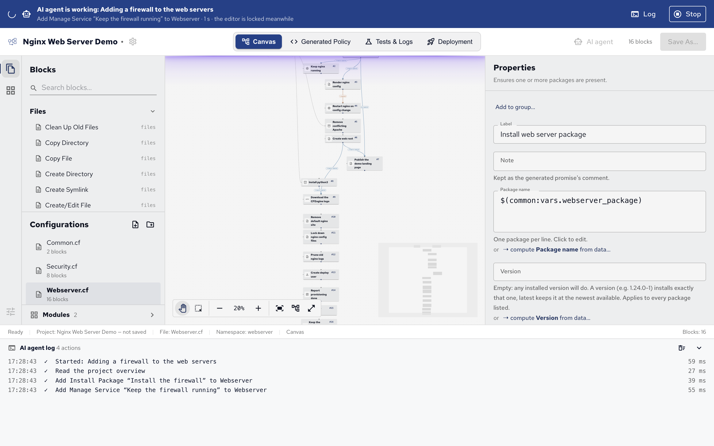

AI agents such as Claude Code can build and change a project in Policy Builder while you watch.
Policy Builder runs an MCP server, the standard way AI agents use the tools of other applications: through it, an agent adds blocks, connects them, sets variables and conditions, adds modules and runs tests, with every change showing on the canvas as it's made.
The agent uses its own account and model; Policy Builder doesn't send your project anywhere itself.

## Connecting an agent

1. Click **AI agent** in the top bar, or choose **File**, then **Connect AI Agent…**.
2. Turn on **Let AI agents connect**.
3. Pick your **Agent**: Claude Code, Gemini CLI, OpenAI Codex, VS Code (Copilot), Cursor, or another MCP client.
4. Copy what Policy Builder shows and use it as it says: a command to run once in a terminal, or settings to add to the agent's configuration file.



For Claude Code, the command looks like this:

```command
claude mcp add --transport http --scope user cfengine-policy-builder http://127.0.0.1:<port>/mcp --header "Authorization: Bearer <token>"
```

Only programs on your computer that know the token can connect.
Keep Policy Builder open, with the project the agent should work on: the agent works on the open project, and nothing is saved until you or the agent save it.

Then ask the agent in its own window, for example: "In Policy Builder, add a block that installs chrony and keep the chronyd service running after it."

## What an agent can do

An agent can always read the project: its files, blocks, generated policy, variables and test results.
What it may change is set in the same dialog, under **What agents may do**, for every agent at once:

| Permission                         | Lets an agent                                                                   |
| ---------------------------------- | ------------------------------------------------------------------------------- |
| **Edit blocks and variables**      | Add and change blocks, arrows, groups, entries, transformers and conditions.    |
| **Files and folders**              | Add, rename and describe policy files and folders.                              |
| **Create, open and save projects** | Write the project to disk.                                                      |
| **Run tests**                      | Set up test environments and run them in Docker.                                |
| **Allow deleting**                 | Remove blocks, arrows, entries, transformer steps, files and test environments. |

What's turned off isn't offered to agents at all.
(_Transformers_ are a variable's transforms, described in [Values and templates][].)
Agents also get a guide to working in Policy Builder, so they use the blocks, check their work and ask you before judgement calls such as a schedule or a looser permission.

## While an agent works

When an agent starts working, a bar at the top of the window says what it's doing, and the editor is locked so the two of you don't edit at the same time.
**Log** opens a panel at the bottom that lists each step the agent took, and how long it took.



**Stop** stops the agent at once: its next call is refused, and it's told you stopped it. You can add a **Note for the agent**, such as "wrong project", to tell it why.
**Allow again** lets it continue.

## Reviewing an agent's changes

Each change an agent makes is one undo step, so ⌘Z takes back its changes one at a time.
Before saving, read what it built:

- the canvas, and each block's settings in Properties;
- the **Generated Policy** view, for the exact policy;
- **Tests & Logs**, if it ran tests.

The guide asks agents to record their decisions in the note of the block they affect, so check the notes too.
