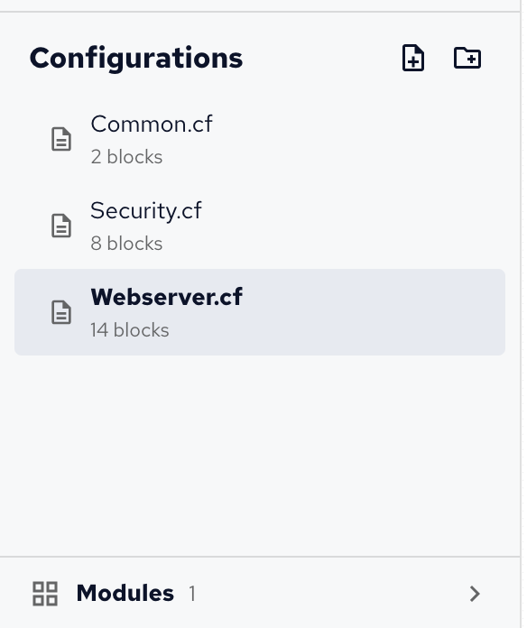
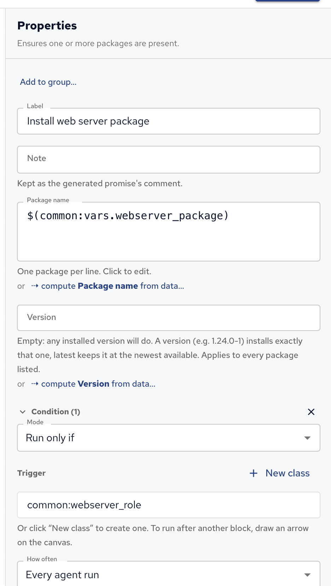
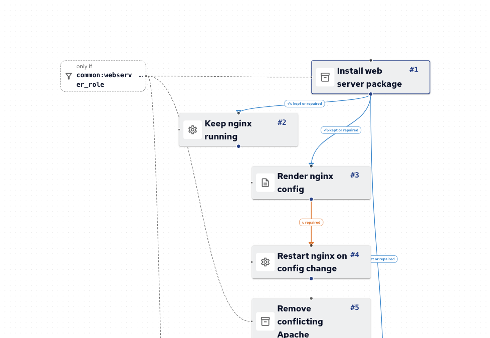
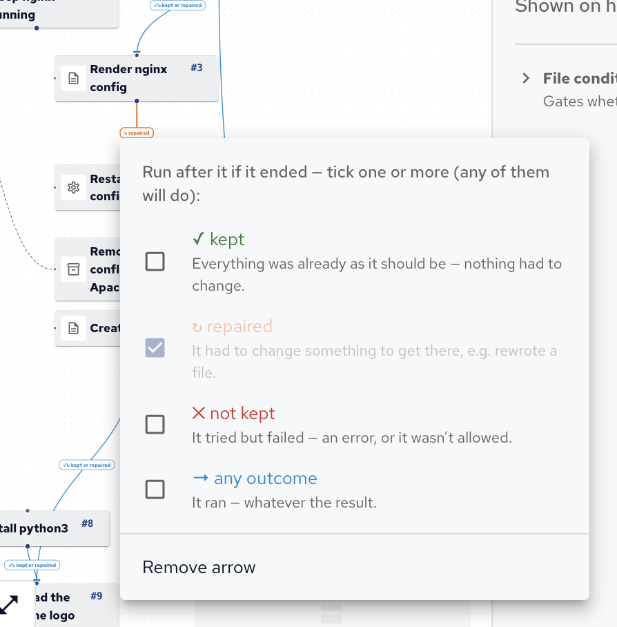
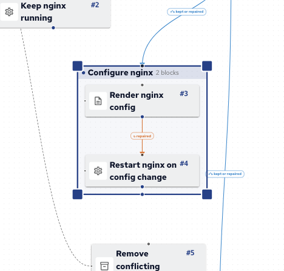

A project's policy is split into configurations, and each configuration has its own canvas, where each block is one thing a host should have or do.
This page starts with configurations, then explains how to work with blocks, how to order them with arrows, how to make them apply only to some hosts, and how to group them.

Shortcuts are written for macOS; on Windows and Linux, use Ctrl for ⌘ and Alt for ⌥.

## Configurations

A _configuration_ is one policy file of the project, with its own canvas of blocks.
The project's configurations are listed under **Configurations** in the side bar; click one to open its canvas.
(The **Files** category in the Blocks palette is something else: blocks that manage files on the hosts.)

A new project starts with one configuration, named after the project.

- The icons next to **Configurations** add a configuration or a folder. Type its name, and press Enter.
- Right-click a configuration or folder to rename or delete it, or drag it into another folder.
- Deleting a folder deletes the configurations in it. A project always keeps at least one configuration.
- Hover a configuration's name to read its description, and the number under it is its block count.

Folders organize the list, and the project folder too: a configuration's policy file is written in the same folder in the project, such as `roles/webserver.cf`.

### When to start a new configuration

One configuration is enough for a small policy. Start a new one when:

- **A set of blocks serves one role**, such as a web server or a database server. A configuration per role, with a [file condition](#configuration-settings) on the role's class, makes each role's policy easy to find and to switch on or off.
- **Several configurations share values**, such as a package name or a port. Put the Define Variable and Define Class blocks they share in a configuration of their own, like the demo's **Common.cf**, and refer to them from the others.
- **Something applies to every host**, such as hardening or a login banner: a baseline configuration, like the demo's **Security.cf**, keeps it apart from role-specific policy.
- **A canvas gets hard to follow.** Around fifteen to twenty blocks, splitting by purpose usually reads better than one long column. Groups help too, inside one configuration: see [Groups](#groups).

Use folders once there are several of the same kind, such as `roles/` for role configurations and `baseline/` for what every host gets.

### Namespaces

Each configuration is a CFEngine _namespace_, named when it's created, such as `common` for **Common.cf**: renaming it later doesn't change the namespace, so choose the name with care.
Variables and classes are referred to by their name in the same configuration, and with the namespace in front from another one, such as `$(common:vars.webserver_package)`.
See [Namespaces][] for how CFEngine uses them.

### Configuration settings

With no block selected, Properties shows the open configuration's settings:

- **Description**: what it does, shown when you hover its name and at the top of its generated policy.
- **File condition**: a class expression that guards every promise in the configuration, its variables and classes included, such as `webserver_role` for only the hosts with that class. A banner on the canvas shows it.

## Blocks

Add a block by clicking it in the **Blocks** palette or dragging it onto the canvas.
Click a block to select it and edit it in **Properties**:

- **Label**: what the block achieves, short and specific, such as "Install nginx" or "Render nginx config". The label names the block in the generated policy too.
- **Note**: why the block is there. It's kept in the generated policy, as the promise's comment.
- The block's own settings, described in the [Block reference][].
- **Condition** and **How often**, described below.

Each block on the canvas shows its number in run order (`#1`, `#2`…) and the promise type it generates, such as `packages`.
To select several blocks, drag a box around them with ⇧ held (or with the **Select** tool), or press ⌘A to select every block.
⌘X, ⌘C and ⌘V cut, copy and paste blocks, also into another configuration, and ⌫ (Delete on Windows and Linux) deletes the selection.

Each block is a _promise_: a statement about the host that the CFEngine agent checks on every run, by default every five minutes.
Each check ends in one of three _outcomes_:

| Outcome      | Meaning                                                               |
| ------------ | --------------------------------------------------------------------- |
| **kept**     | Everything was already as it should be: nothing had to change.        |
| **repaired** | The agent changed something to get there, for example rewrote a file. |
| **not kept** | It tried but failed, for example the package couldn't be installed.   |

## Arrows and outcomes

Without arrows, blocks run in canvas order: top to bottom, then left to right.
An arrow from one block to another means: run the second block after the first, if the first ended with one of the arrow's outcomes.
Drag from the dot at the bottom of a block to the dot at the top of another to draw one.

A new arrow waits for **kept** or **repaired**: "after the first block succeeded".
Some blocks start with **repaired** instead, because their success always means a change: Run Command, Cron Job, Render Template, Custom CFEngine, the blocks that edit a file's contents, and blocks that clean up or watch files. The [Block reference][] doesn't list them separately; the arrow's label shows what it waits for.
Click the label on an arrow to choose its outcomes; ticking several means any of them will do.

Two patterns come up often:

- **Reacting to a change**: put a restart or reload behind a **repaired** arrow from what changes the configuration, such as **Render Template** to **Manage Service** with the action restart. Without that arrow, the service restarts on every agent run. Properties warns about this.
- **Handling a failure**: a **not kept** arrow runs a block only when the one before it failed, for example a **Report Message** that says so.

Arrows can't form loops.
Define Variable and Define Class blocks have no arrows: other blocks use their variables and classes instead.

## Conditions

A _class_ in CFEngine is a named true or false flag.
CFEngine sets many on every host by itself, such as `linux`, `debian`, `ubuntu_22`, `redhat`, `x86_64` or `Monday`; these are _hard classes_.
Your policy can define more, such as `webserver_role`, with a **Define Class** block.

A condition limits a block to hosts where a class expression is true:

1. Select the block, open **Condition** in Properties, and click **Add condition**.
2. Choose the **Mode**: **Run only if** the expression is true, or **Skip if** it is.
3. In **Trigger**, type the class expression. As you type, it suggests classes: the hard classes, each with what it means, and the ones your project defines. **New class** creates a class for the project, in a Define Class block.

Class expressions combine classes:

| Expression                | True when                           |
| ------------------------- | ----------------------------------- |
| `debian`                  | the host runs Debian                |
| `debian\|redhat`          | the host runs Debian or Red Hat     |
| `linux.!debian`           | the host runs Linux, but not Debian |
| `(debian\|ubuntu).x86_64` | Debian or Ubuntu on x86-64          |

A class defined in another configuration is written with that configuration's namespace in front, such as `common:webserver_role` (see [Namespaces](#namespaces)).
The canvas draws a condition as an **only if** or **skip if** label linked to the block.
See [Classes and decisions][] for more on classes.

A condition decides _whether_ a block runs at all; an arrow decides _when_ it runs, relative to another block, and on which outcome.

## Groups

Select several blocks and press ⌘G to group them, then name the group in Properties; ⇧⌘G ungroups them.
A group is drawn as a frame, and runs as one step: in the generated policy, it's a bundle of its own.

- An arrow into a group runs the whole group after the source.
- An arrow out of a group reads the group's combined outcome: not kept if any of its blocks failed, else repaired if any of them changed something, else kept.
- A condition on a group applies to all its blocks.

Use groups for blocks that belong together, such as "Configure nginx", and to gate them all with one condition.

## How often

A block runs on every agent run unless **How often** in Properties limits it to **at most once an hour**, **once a day** or **once a week**.
That suits work that doesn't need checking every few minutes, such as downloading a file or sending a report.

Some blocks come with a limit already: **Run Command** runs at most once a day until you change it, because a command runs again every time it's checked.
Test environments ignore How often, so every test run runs every block.

## Tidy, zoom and full screen

- **Tidy up** in the canvas toolbar lays the open configuration out in run order, top to bottom.
- Zoom with + and - (or ⌘= and ⌘-), press 0 for actual size and 1 to fit the whole configuration. The minimap in the corner shows the whole configuration; drag in it to move around.
- The full screen button hides the side bar and Properties, to give the canvas the whole window.
