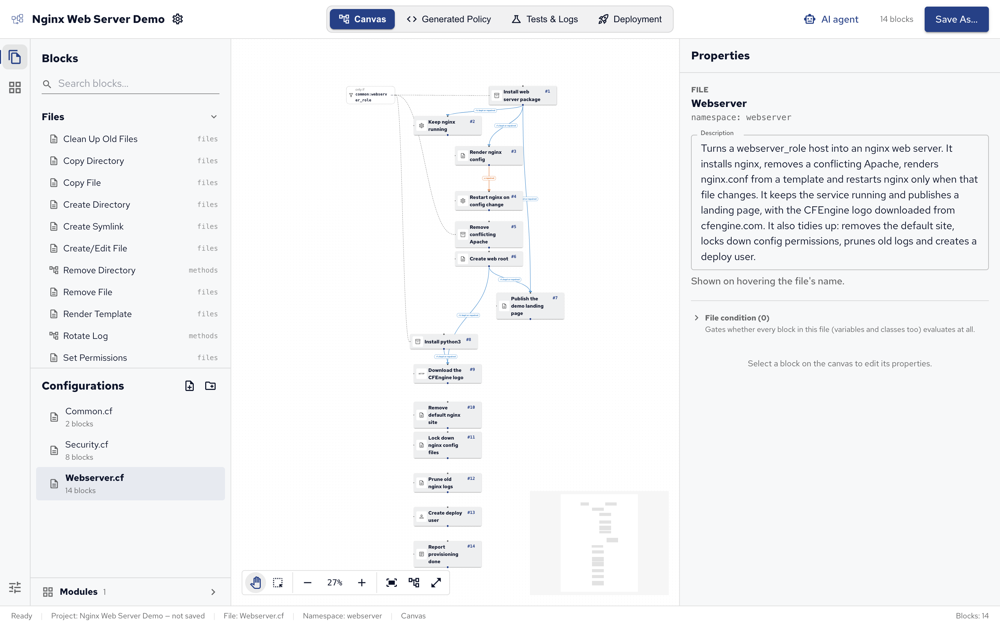
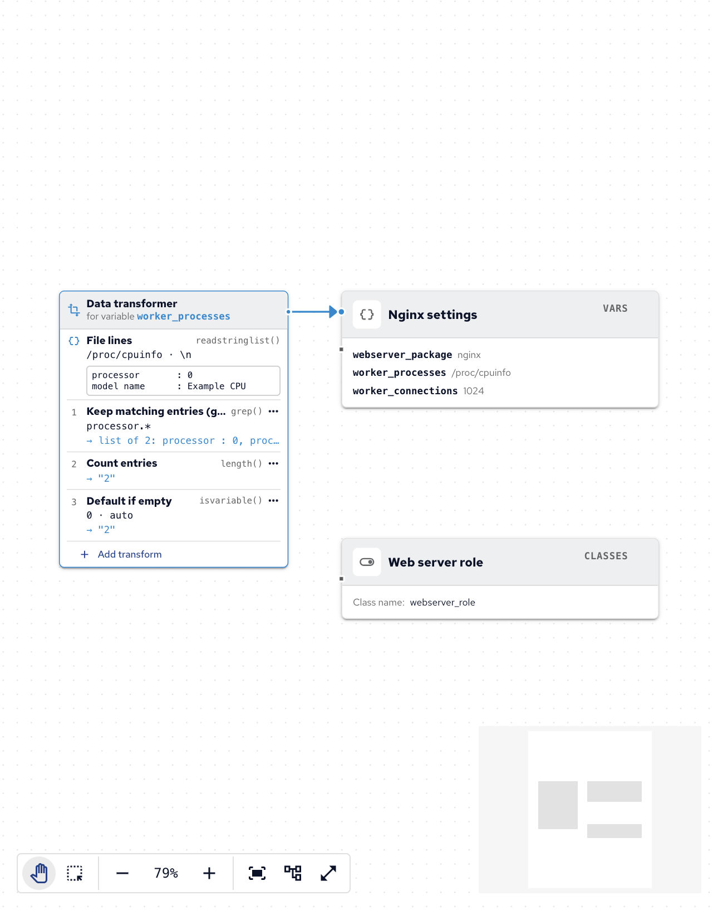
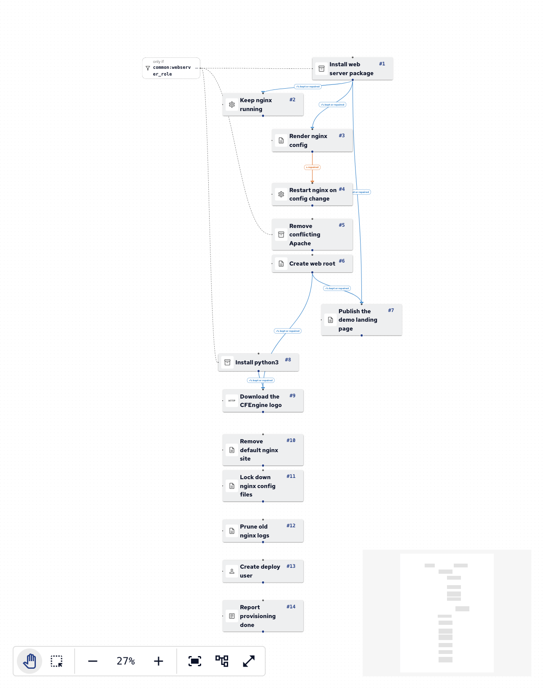
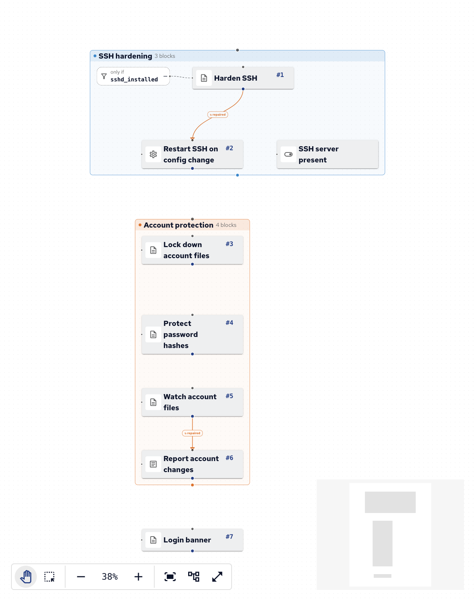
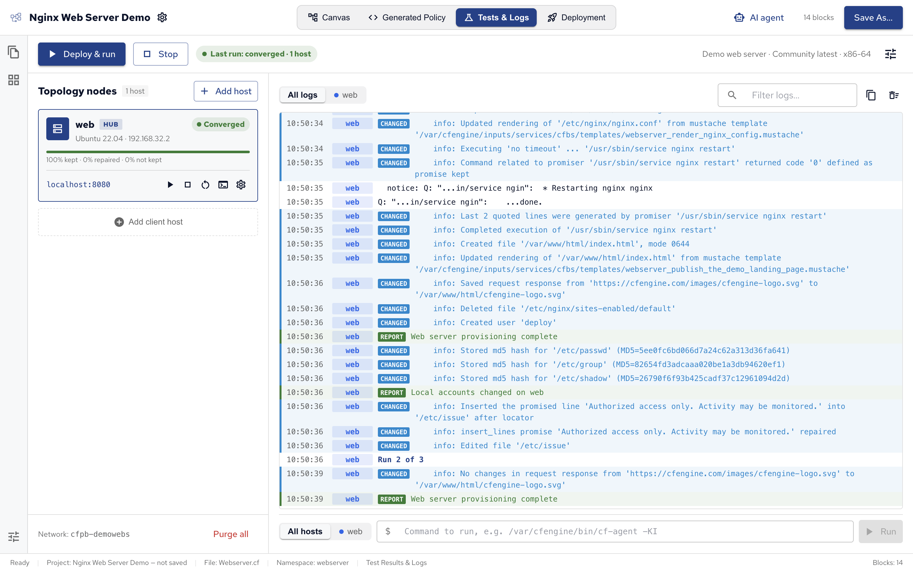
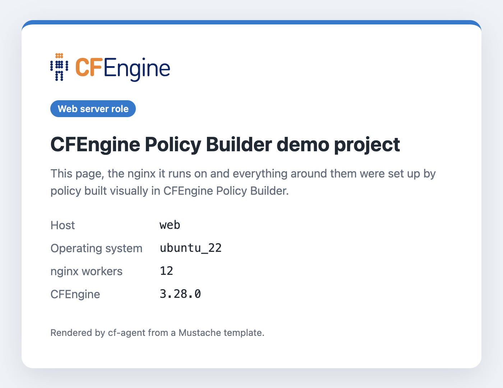
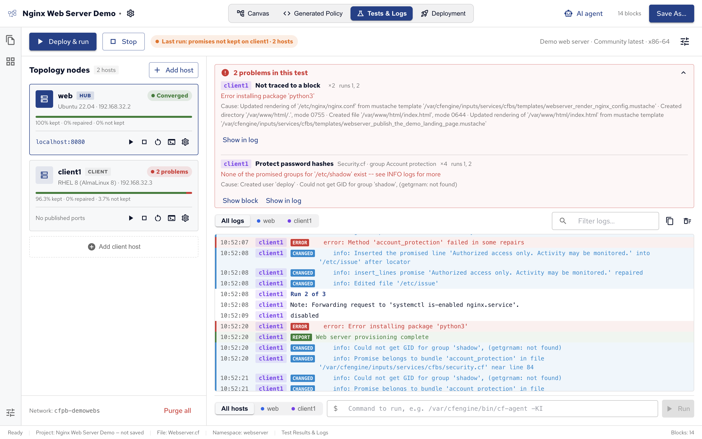

Policy Builder comes with a demo: _Nginx Web Server Demo_, a complete project that turns a host into an nginx web server and hardens it.
It shows the parts of Policy Builder described in this section working together: several configurations, variables shared between them, arrows that react to changes, groups, templates and a module.
The demo isn't saved anywhere until you choose to, so change whatever you like.

## Opening the demo

On the start screen, click **Try Demo: Nginx Web Server** under **or explore**, or choose **File**, then **Try Demo: Nginx Web Server**.
It opens on **Webserver.cf**:

The demo has three configurations, listed under **Configurations** in the side bar:

| Configuration    | Namespace   | What it does                                               |
| ---------------- | ----------- | ---------------------------------------------------------- |
| **Common.cf**    | `common`    | Values and a class the other configurations use.           |
| **Webserver.cf** | `webserver` | Installs, configures and runs nginx, and publishes a page. |
| **Security.cf**  | `security`  | Baseline hardening for every host.                         |

Each configuration runs its blocks in their numbered order, top to bottom. Below, each one is described block by block.

## Common.cf

Common.cf holds what the other two configurations share, so it has no arrows: its blocks define values instead of acting on the host.

- **Nginx settings** (Define Variable) defines three variables:
  - `webserver_package`: `nginx`, the package to install.
  - `worker_processes`: how many nginx worker processes to start, counted from the host's CPUs. It reads the lines of `/proc/cpuinfo`, keeps those matching `processor.*`, counts them, and falls back to `auto` if that fails. The card beside the block shows each of these transforms with its result on sample data.
  - `worker_connections`: `1024`, the connections each worker accepts.
- **Web server role** (Define Class) defines the class `webserver_role`. Here it's always true, standing in for a real test of which hosts are web servers; the blocks that set up nginx run only where it's true.

Webserver.cf uses these as `$(common:vars.webserver_package)` and `common:webserver_role`: the namespace `common`, then the name. See [Values and templates][].

## Webserver.cf

Webserver.cf sets up nginx, in run order:

1. **Install web server package** (Install Package) installs `$(common:vars.webserver_package)`, only where `common:webserver_role` is true. Most of the file waits for it.
2. **Keep nginx running** (Manage Service) starts nginx and keeps it running, after the package is installed (arrow: kept or repaired).
3. **Render nginx config** (Render Template) writes `/etc/nginx/nginx.conf` from a template that uses `worker_processes` and `worker_connections`, after the package is installed.
4. **Restart nginx on config change** (Manage Service) restarts nginx, only when the config file was just rewritten: its arrow from Render nginx config waits for **repaired**. Without that arrow, nginx would restart on every agent run.
5. **Remove conflicting Apache** (Remove Package) removes `apache2`, which would compete for the same port, only on web servers.
6. **Create web root** (Create Directory) makes sure `/var/www/html` exists.
7. **Publish the demo landing page** (Render Template) writes `/var/www/html/index.html` from a template, after both the package and the web root (two arrows, kept or repaired). The page shows a **Web server role** badge on hosts where that class is true.
8. **Install python3** (Install Package) installs Python, which the next block's module needs, only on web servers.
9. **Download the CFEngine logo** (HTTP Request) downloads the logo for the landing page to `/var/www/html/cfengine-logo.svg`, after the web root exists and Python is installed. **How often** is once a day: the logo doesn't change, so there's no need to check every few minutes. Its promise type comes from the `promise-type-http` module, which the project lists under Modules.
10. **Remove default nginx site** (Remove File) removes `/etc/nginx/sites-enabled/default`.
11. **Lock down nginx config files** (Set Permissions) keeps `/etc/nginx/nginx.conf` and `/etc/nginx/conf.d/default.conf` at mode `644`, owned by root.
12. **Prune old nginx logs** (Clean Up Old Files) deletes files in `/var/log/nginx` untouched for 30 days.
13. **Create deploy user** (Manage Users) makes sure a `deploy` user exists.
14. **Report provisioning done** (Report Message) prints `Web server provisioning complete` in the agent's output.

Blocks 10 to 14 have no arrows, so they simply run in order, every agent run.
See [Building policy on the canvas][] for arrows and conditions.

## Security.cf

Security.cf hardens every host. It has no file condition, and its blocks are in two groups, each a bundle of its own in the generated policy:

- **SSH hardening** group:
  - **SSH server present** (Define Class) defines `sshd_installed`, true where `/etc/ssh/sshd_config` exists.
  - **Harden SSH** (Set Config Values) sets `PermitRootLogin no`, `MaxAuthTries 3` and `X11Forwarding no` in `/etc/ssh/sshd_config`, only where `sshd_installed` is true, so hosts without an SSH server are left alone.
  - **Restart SSH on config change** (Manage Service) restarts the `ssh` service, only when Harden SSH changed the file (arrow: repaired).
- **Account protection** group:
  - **Lock down account files** (Set Permissions) keeps `/etc/passwd` and `/etc/group` at mode `644`, owned by root.
  - **Protect password hashes** (Set Permissions) keeps `/etc/shadow` at mode `640`, owned by root and the `shadow` group.
  - **Watch account files** (Watch File for Changes) watches `/etc/passwd`, `/etc/group` and `/etc/shadow` for changes.
  - **Report account changes** (Report Message) reports `Local accounts changed on $(sys.fqhost)`, only when Watch account files saw a change (arrow: repaired).

These settings suit the demo's Debian and Ubuntu test hosts. On Red Hat-family hosts the SSH service is `sshd`, and `/etc/shadow` has no `shadow` group: it's owned by root with mode `000`.

**Login banner** (Ensure Lines in File), outside the groups, puts `Authorized access only. Activity may be monitored.` in `/etc/issue`.

## Reading its policy

Switch to **Generated Policy** in the top bar to read the CFEngine policy each configuration becomes.
Selecting a block highlights its lines.
[Generated policy][] explains how to read it.

## Testing it

If Docker runs on your computer, open **Tests & Logs** and click **Deploy & run**.
The demo comes with a test environment: one Ubuntu host, `web`, that is also its own hub, with port 8080 published.
The first run takes a few minutes, while Policy Builder downloads the host's image and CFEngine.
When it finishes, the host shows **Converged**: every promise was kept.

Open http://localhost:8080 to see the landing page the policy published, filled in by its template, with the CFEngine logo it downloaded:

See [Test environments][].

## Seeing what problems look like

The demo is written for Debian and Ubuntu, so a Red Hat-family host shows on purpose what a test with problems looks like.
Click **Add client host**, choose **RHEL 8 (AlmaLinux 8)**, and click **Deploy & run** again.

The client shows **2 problems**, and the list above the logs explains each one: the error, the block it comes from (or **Not traced to a block** when the log line doesn't say), and what the agent did just before it.
**Show block** selects the block on the canvas, and **Show in log** jumps to the lines in the log.

- **Error installing package 'python3'**: on RHEL 8, `python3` is only a name the installed `python36` package answers to.
  `dnf install python3` finds nothing to do, but CFEngine looks for a package called exactly `python3`, doesn't find one, and reports the install as failed.
  To fix it, install the package by its RHEL 8 name there: in Common.cf, add a variable with the **Per condition** source, `python36` where `almalinux_8` holds (the test host's class for AlmaLinux 8) and `python3` otherwise, and use it as **Install python3**'s package name, as Install nginx uses `$(common:vars.webserver_package)`.
- **None of the promised groups for '/etc/shadow' exist**, from **Protect password hashes**: RHEL has no `shadow` group.
  There `/etc/shadow` is owned by root, with mode `000`.
  To fix it, give the block the condition `debian`, and add a second Set Permissions block with the condition `redhat` (true on RHEL and AlmaLinux) and their owner, group and mode.

The same goes for **Restart SSH on config change**: on RHEL the service is `sshd`, not `ssh`.

## Saving a copy

To keep the demo, or start your own project from it, click **Save As…** and choose where to save it.
It then works like any other project: see [Policy Builder projects][].
