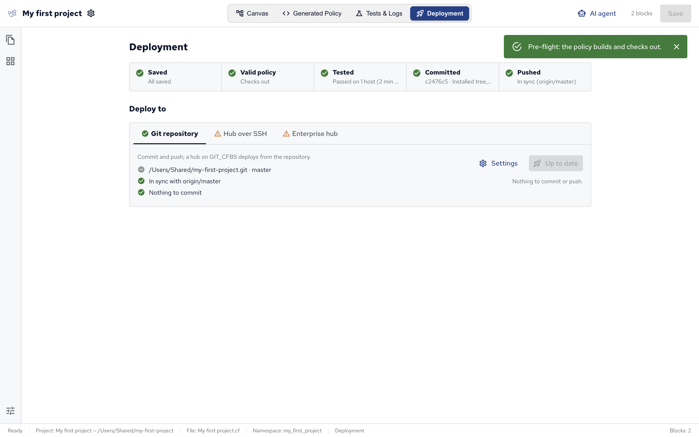

When the policy is ready, Policy Builder gets it to your CFEngine hub, the policy server your hosts fetch their policy from.
Open **Deployment** in the top bar (⌘4).

Deployment works on a project saved to a folder: a project that isn't saved yet, such as the demo, asks you to save it first.
A module project is deployed as part of the policy set that uses it.

## Which way to deploy

| Your hub                | Deploy                                                                                                                                                                     |
| ----------------------- | -------------------------------------------------------------------------------------------------------------------------------------------------------------------------- |
| CFEngine Enterprise     | Through a git repository: push the project (**Git repository** tab), and the hub deploys what's pushed (**Enterprise hub** tab). Best for teams: every change is a commit. |
| CFEngine Community      | Over SSH (**Hub over SSH** tab): Policy Builder copies the built policy set to the hub.                                                                                    |
| Enterprise, without git | Over SSH works with an Enterprise hub too.                                                                                                                                 |

Use one way per hub: a hub that deploys from git replaces policy copied over SSH on its next update.

## Pre-flight checks

The row at the top checks the project before it's deployed:

| Check            | Passes when                                                                                        |
| ---------------- | -------------------------------------------------------------------------------------------------- |
| **Saved**        | The project has no unsaved edits. Pre-flight saves them for you.                                   |
| **Valid policy** | The policy set builds with `cfbs build`, and the CFEngine linter and `cf-promises` find no errors. |
| **Tested**       | The last run in a [test environment][Test environments] passed. A warning, not a blocker.          |
| **Committed**    | The project folder is a git repository with nothing left to commit.                                |
| **Pushed**       | The repository's commits are pushed to its remote, and the remote has none you don't.              |

**Run pre-flight** runs them all.
Deploying runs them too, and stops if the policy has problems: **Valid policy** then lists them, with the blocks they come from.
If you change the project after a check, the view says so, and the next deploy checks again.

## Git repository

The **Git repository** tab commits the project and pushes it to a remote repository, such as one on GitHub or GitLab.

1. If the project folder isn't a git repository yet, the tab offers to initialize one.
2. Set **Remote (origin)** to the repository to push to, such as `git@github.com:example/policy.git`, and click **Set**. Once a remote is set, **Settings** changes it.
3. Click **Commit & push**, write a commit message, and confirm.

Pushing uses your own git credentials (your SSH agent or credential helper); Policy Builder stores none.
If the remote has commits you don't, the **Pushed** check offers two ways out: **Pull theirs, then push** replays your commits on top of theirs, pushes, and reloads the project; **Overwrite the remote** replaces their commits with yours.

## Hub over SSH

Policy Builder can copy the built policy set to a hub over SSH, as its masterfiles, with `cf-remote`. This works with Community and Enterprise hubs.

1. On the **Hub over SSH** tab, open **Settings** and set the **Hub**, such as `root@hub.example.com`, its SSH **Port** (22 by default) and the **Private key** to sign in with.
2. Click **Deploy to** the hub: Policy Builder saves, builds and checks the policy set, then copies it to the hub, installs it and runs the hub's agent.

The hub's hosts get the new policy on their next agent run, within about five minutes.

## Enterprise hub

A CFEngine Enterprise hub can deploy from a git repository: it pulls the repository, builds it with `cfbs` and deploys the result. See [Version control][] for how it works on the hub.
The **Enterprise hub** tab sets this up from Policy Builder, after the project is pushed (see [Git repository](#git-repository)).

1. **Connect a hub…**: the URL of its Mission Portal (the hub's web interface), and a Mission Portal user name and password.
2. Choose **Point the hub at this project…** and check what the hub pulls: the **Repository the hub pulls**, its **Branch** and, if the project isn't at the repository's top, its **Subdirectory**.
3. Choose how the hub signs in to the repository under **Access**:
   - **Public repository**: no credentials.
   - **Username + token**: a user and an access token for the repository.
   - **Deploy key**: the private half of an SSH key added to the repository as a deploy key, a key that only reads that one repository. An SSH repository URL needs one.

Policy Builder saves these settings on the hub and turns on deploys from version control there.
If the hub already deploys another source, the tab says so and offers **Fix the hub's source…**.

Then **Commit, push & deploy to hub** does everything in one go: it commits and pushes your changes, and runs the hub's agent, which pulls the repository, builds it, validates the policy and deploys it.
The tab shows which commit the hub runs, and the hub's hosts get the new policy on their next agent run.
