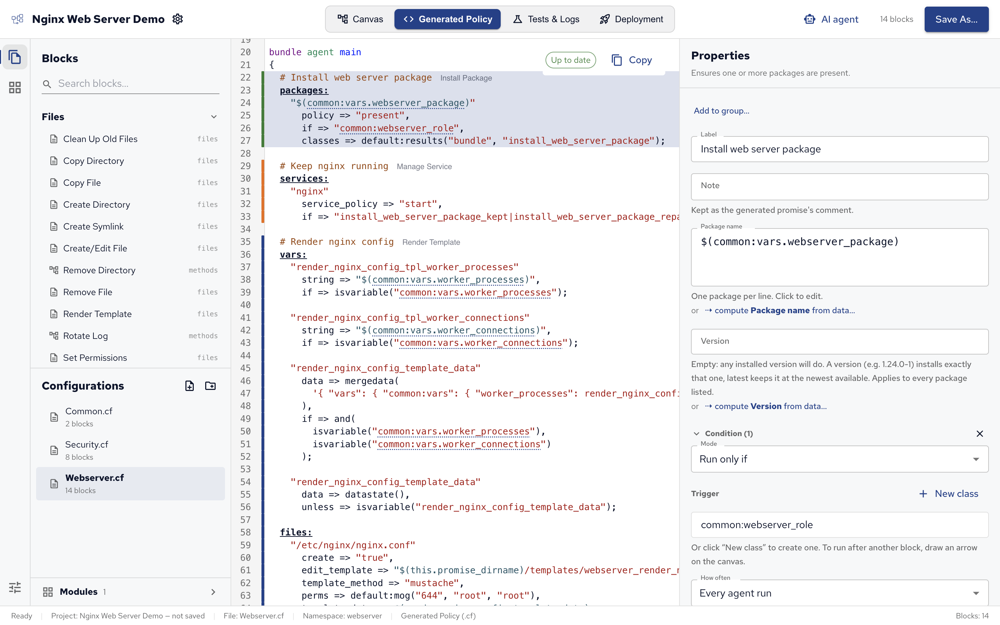

Policy Builder writes CFEngine policy from your blocks.
You never have to edit it, but reading it shows exactly what your hosts will do, and it's a good way to learn the policy language.

## The Generated Policy view

Open **Generated Policy** in the top bar (⌘2) to read the open configuration's policy.



- It follows your edits as you make them, before you save: **Up to date** shows it matches the canvas, **Updating…** that it's catching up.
- The lines of the selected block are highlighted, with the block's type next to its comment.
- References are links: click `$(common:vars.webserver_package)` to jump to where the variable is defined, and press ⌥← to go back.
- **Copy** copies the whole file.

## From blocks to policy

Here is part of the demo's **Webserver.cf**, as Policy Builder generates it.
Each configuration starts with its description and its namespace:

```cf3
###############################################################################
#
# Turns a webserver_role host into an nginx web server. It installs nginx,
# removes a conflicting Apache, renders nginx.conf from a template and restarts
# nginx only when that file changes. It keeps the service running and publishes
# a landing page, with the CFEngine logo downloaded from cfengine.com. It also
# tidies up: removes the default site, locks down config permissions, prunes
# old logs and creates a deploy user.
#
# Generated by CFEngine Policy Builder from "Webserver".
# Edits here are overwritten when the project is saved.
#
###############################################################################
body file control
{
  namespace => "webserver";
  evaluation_order => "top_down";
}
```

`evaluation_order => "top_down"` makes CFEngine run the promises in the order they're written, which is the canvas's run order. It's new in CFEngine 3.27, so hosts need 3.27 or later: older agents refuse the policy (see [What you need][Policy Builder#What you need]).

The blocks become promises in the file's `main` bundle, each under a comment with its label:

```cf3
bundle agent main
{
  # Install web server package
  packages:
    "$(common:vars.webserver_package)"
      policy => "present",
      if => "common:webserver_role",
      classes => default:results("bundle", "install_web_server_package");

  # Keep nginx running
  services:
    "nginx"
      service_policy => "start",
      if => "install_web_server_package_kept|install_web_server_package_repaired";
}
```

Reading it:

- `packages:` and `services:` are _promise types_: what kind of thing the promise is about. The quoted string under them, the _promiser_, is what the promise is about: the package, the service.
- `if => "common:webserver_role"` is the block's condition: only hosts where the class `webserver_role`, defined in **Common.cf**, is true.
- `classes => default:results("bundle", "install_web_server_package")` sets classes from the promise's outcome: `install_web_server_package_kept`, `_repaired` or `_not_kept`. Policy Builder adds it when an arrow leaves the block.
- The arrow to **Keep nginx running** became its `if`: the service is started only after the package promise ended kept or repaired.

Some settings show up as attributes of the promise:

- A note becomes `comment => "…"`. Promise types from modules don't take a comment, so there it's a `# Note:` line above the promise.
- **How often** becomes `action => default:if_elapsed("1440")`, the number of minutes between runs.

Define Variable and Define Class blocks go into a `bundle common vars` in their configuration, which is why other blocks refer to their variables as `$(vars.name)`, or `$(namespace:vars.name)` from another file.
A group, a Custom CFEngine block and some blocks that use the standard library become bundles of their own, called from `main` with a `methods:` promise in their place.

See [Promises][], [Promise types][] and [Bundles][] for the language itself.

## Files and layout

Each configuration is one `.cf` file in the project folder, at its place in the Configurations tree.
`cfbs.json` lists them, with their `main` bundles, so `cfbs build` adds them to the policy set and the agent runs each file's `main` bundle.
Templates of Render Template blocks go into `templates/`, shipped with the policy.

## Checks

Policy Builder checks the generated policy in two ways:

- The **CFEngine linter** checks the text of Custom CFEngine blocks as you type.
- **cf-promises**, CFEngine's own policy checker, validates the built policy set during the Deployment view's pre-flight, under **Valid policy**. See [Deploying from Policy Builder][].

Problems found while testing, or by a hub that refuses the policy, are traced back to the block that caused them.
