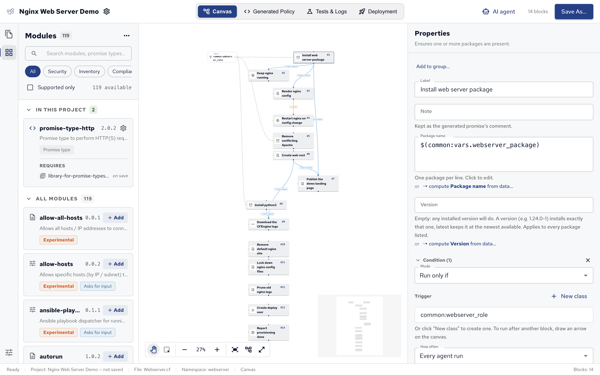
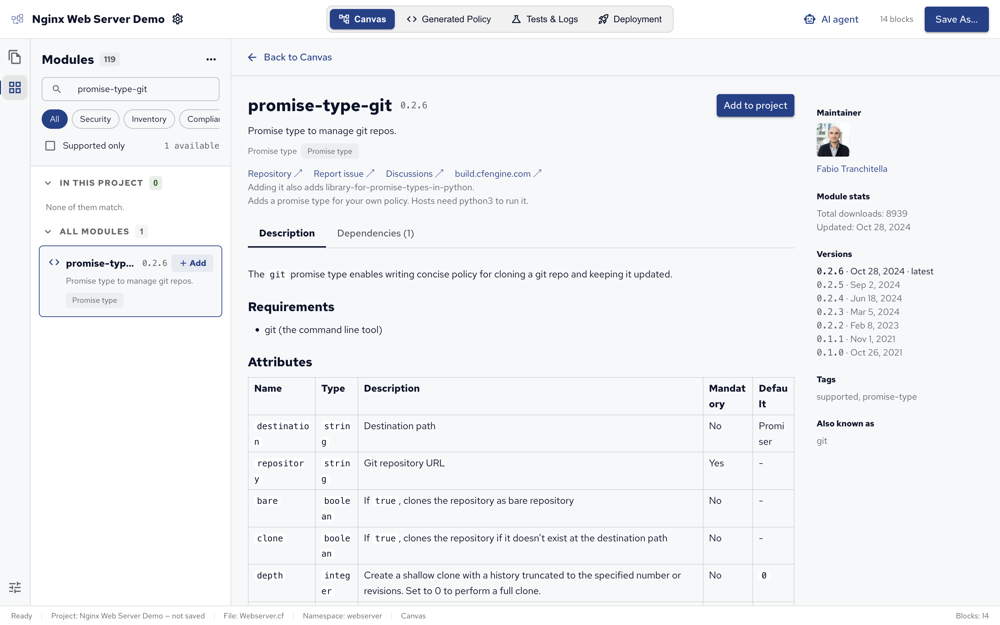
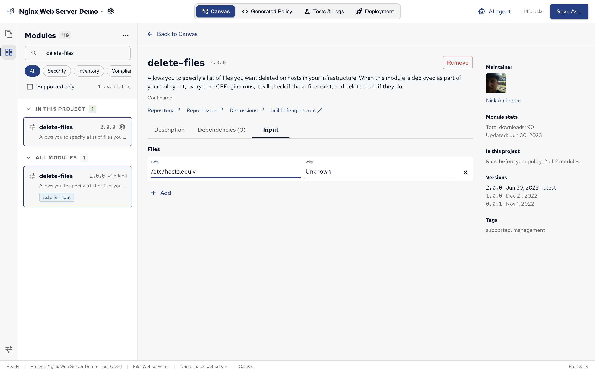

[CFEngine Build](https://build.cfengine.com) has ready-made modules for inventory, compliance reports, security hardening, common tasks and new promise types.
Policy Builder can browse them, add them to a project and answer their questions, and installs them with `cfbs` when you save.

Modules are for policy sets: a project of the module type can't add them (see [Policy Builder projects][]).

## Browsing modules

Click **Modules** in the activity bar (⇧⌘X) to open the Modules view.

- **Search modules, promise types…** filters the list by name and description.
- The chips filter by tag: **Security**, **Inventory**, **Compliance**, **Management**, **Promise types**, **Windows**, **SSH** and **Libraries**.
- **Supported only** shows only the modules CFEngine supports.
- **In this project** lists the project's modules, in the order they run; **All modules** lists the rest.

Libraries, modules that other modules need, are hidden unless you pick the **Libraries** chip, search for one or choose **Show libraries** in the **…** menu.
The same menu's **Refresh list** downloads the list again.

Each module shows its version and badges: **Experimental** for modules not yet considered stable, **Asks for input** for modules with questions to answer, and **Promise type** for modules that add a promise type.

The list comes from build.cfengine.com and is kept on your computer, so the view works offline with the last list downloaded; it says so, with the date.

A search in the **Blocks** palette that finds no block offers **Browse modules…**, which searches the modules for the same words.

## A module's page

Click a module to open its page, as on build.cfengine.com:

- **Description**: the module's README.
- **Dependencies**: the modules it needs, which are added with it.
- **Input**: the module's questions, when it has any.
- On the side: links to its repository and documentation, its maintainer, versions and download statistics.

**Add to project** adds it, and **Remove** takes it out again.
**Back to Canvas**, or the **Blocks and files** icon, returns to the canvas.

## Adding a module

Click **Add** on a module in the list, or **Add to project** on its page.
Its dependencies are added with it, shown under **Requires** in its card. A dependency that saving will add shows **on save**.

Nothing is installed until you save: saving runs `cfbs add` for new modules and `cfbs remove` for removed ones, so it needs internet access and can take a while.
Modules run before the project's own policy, in the order listed under **In this project**.
They aren't blocks and have no arrows.

## Answering a module's input

Some modules ask questions before they can work, such as delete-files, which asks which files to delete.
Until every question is answered:

- the Modules icon in the activity bar shows how many modules need input;
- the module's card has an orange border and an **Answer its input** button, and a line above the list names it;
- the **Modules** row under Configurations says how many need input.

Answer on the module page's **Input** tab: a question takes text, a list of texts, or a list of rows with several fields each.

The answers are saved in the project, in the module's `input.json`, and undo takes an answer back like any other change.

## Blocks from modules

Four blocks use promise types that come from CFEngine Build modules: **Git Checkout**, **HTTP Request**, **Systemd Unit** and **Run Ansible Playbook**. [Blocks from modules][] lists their settings, and which module each needs.

Adding one of these blocks adds its module to the project, and the module stays while a block uses it.
Prefer them to running commands: they report kept and repaired properly, so arrows and How often work.

These modules run with Python, so hosts need `python3` (test hosts have it).
Properties advises adding an **Install Package** block for `python3` before such a block: **Add Install python3 before it** adds one, connected with an arrow, and **Ignore in this project** stops the advice if your hosts already have Python.

## Removing a module

Choose **Remove…** in a module's gear menu, or **Remove** on its page.
Its dependencies go with it, unless another module still needs them.

A module can't be removed while it's needed: a module a block uses shows **Used by** and the block's label, and a dependency shows **Added for** the module that needs it.
