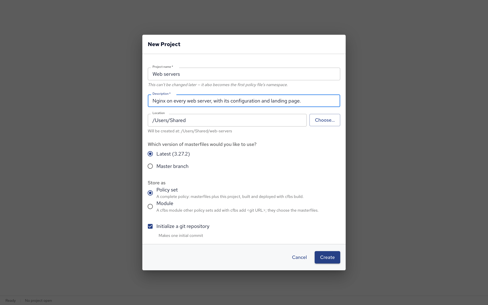

Everything in Policy Builder happens in a project.
This page explains what a project is and what each field of **New Project** means, then how to open, change and save projects.
To explore a complete project first, open [The demo project][].

## What a project is

A Policy Builder project is a folder on your computer holding a CFEngine Build project, the same kind the `cfbs` command line tool works with.
It contains your blocks, the CFEngine policy generated from them, and what's needed to build that policy into something a hub can deploy.

Most projects are **policy sets**: a complete policy for your hosts, made of masterfiles (the standard policy every CFEngine installation starts from) plus your own.
[Project types](#project-types), at the end of this page, explains the other type, modules.

## Creating a project

Click **New Project** on the start screen, or choose **File**, then **New Project…** (⌘N).

| Field                           | What it is                                                                                                                                                                                                                                                                                                                                              |
| ------------------------------- | ------------------------------------------------------------------------------------------------------------------------------------------------------------------------------------------------------------------------------------------------------------------------------------------------------------------------------------------------------- |
| **Project name**                | What the project is called, such as `Web servers`. The project's folder is named after it, in lowercase with dashes (`web-servers`), and so is its first configuration. **The name can't be changed later**: it also becomes that configuration's namespace (`web_servers`), the prefix other configurations use to refer to its variables and classes. |
| **Description** (required)      | A sentence on what the project is for, written into `cfbs.json`.                                                                                                                                                                                                                                                                                        |
| **Location**                    | The folder the project's folder is created in. The dialog shows the full path it will create, and says if it can't create it there.                                                                                                                                                                                                                     |
| **Policy set** or **Module**    | The project's type. Keep **Policy set** unless you're making a module for other projects: see [Project types](#project-types).                                                                                                                                                                                                                          |
| **Masterfiles version**         | For a policy set: **Latest**, the newest released version, which suits most projects, or **Master branch**, the development version, for trying what's coming next.                                                                                                                                                                                     |
| **Initialize a git repository** | Makes the project folder a git repository, with one initial commit. Keep it to track changes and to [deploy to a hub][Deploying from Policy Builder] from git.                                                                                                                                                                                          |

Click **Create**.
Creating a policy set downloads masterfiles, so it needs internet access and can take a moment; **Master branch** and **Initialize a git repository** also need git installed.
If creating fails, the dialog says why, and **Details** shows the full output. Nothing is left behind, so you can try again.

The new project opens with one empty configuration, named after the project, ready for blocks.

## Opening a project

Click **Open Project…** on the start screen, choose **File**, then **Open Project…** (⌘O), or pick one of the recent projects.
Choose the project's folder, the one with `cfbs.json` in it.

You can open a `cfbs` project that wasn't made in Policy Builder, too.
Its masterfiles, modules and other settings are kept when you save, but policy files written by hand don't become blocks: Policy Builder only shows and edits what it generates.

**File**, then **Reload from Disk** reads the project again, for example after pulling changes made elsewhere into its folder.

## Saving, undo and redo

**Save** (⌘S) writes the project to its folder and generates its policy.
It also adds and removes the project's CFEngine Build modules with `cfbs`, which can take a while: the **Save** button and the status bar show **Saving…** until it's done.
A dot after the project's name shows unsaved changes, and Policy Builder asks before closing a project that has them.

Every change on the canvas and in Properties can be undone (⌘Z) and redone (⇧⌘Z, or Ctrl+Y on Windows and Linux); typing in one field counts as one change.
Opening or creating a project starts a new undo history.

## Project settings

Open them from the gear icon next to the project's name, the icon at the bottom of the activity bar, or **File**, then **Project Settings…** (⌘,):

- **Type**: change a policy set into a module or back. Saving converts `cfbs.json`; the other entries in it, masterfiles included, are kept.
- **Masterfiles**: the version a policy set builds on.

## Project types

| Type           | What it is                                                                                                                                                                                                                                                                        |
| -------------- | --------------------------------------------------------------------------------------------------------------------------------------------------------------------------------------------------------------------------------------------------------------------------------- |
| **Policy set** | A complete policy for your hosts: masterfiles plus your own policy, built with `cfbs build` and deployed to a hub as a whole.                                                                                                                                                     |
| **Module**     | A reusable piece of policy, for other policy sets to add to themselves. It has no masterfiles of its own, since the policy set that adds it brings them, and it's tested and deployed as part of a policy set that uses it. A module can't add CFEngine Build modules of its own. |

**Note:** "module" here means a project type. CFEngine Build modules, the ready-made modules from build.cfengine.com, are something you add to a policy set: see [Modules in Policy Builder][].

## What a project folder contains

| Path                                     | What it is                                                                   |
| ---------------------------------------- | ---------------------------------------------------------------------------- |
| `cfbs.json`                              | The CFEngine Build project: its masterfiles, modules and policy files.       |
| `*.cf`                                   | The generated policy, one file per configuration.                            |
| `.policy-builder/project.json`           | The blocks, arrows, groups and canvas layout: what Policy Builder opens.     |
| `.git/`                                  | The git repository, if you chose one.                                        |
| `templates/`                             | Templates of Render Template blocks, once the project has any.               |
| `<module>/input.json`                    | Your answers to a CFEngine Build module's questions, once you've given them. |
| `.policy-builder/test-environments.json` | The project's test environments, once it has any.                            |

**Note:** don't edit the generated files (the `.cf` files, Policy Builder's entries in `cfbs.json`, and `templates/`) by hand.
Saving writes them again from the blocks, and your edits are lost.

## Next steps

- [The demo project][]: a complete project to explore.
- [Building policy on the canvas][]: blocks, arrows, conditions and groups.
