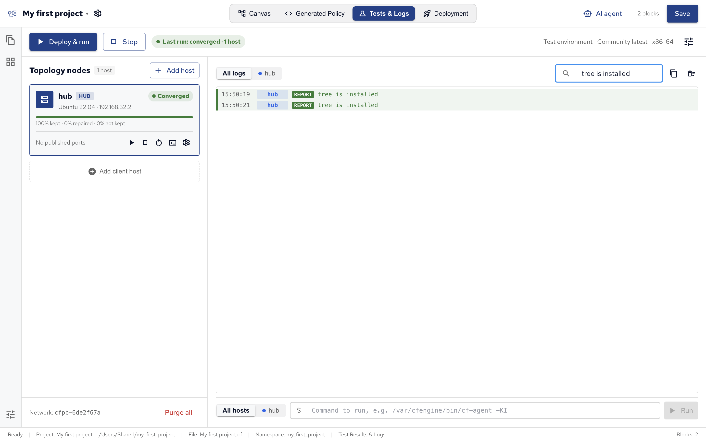
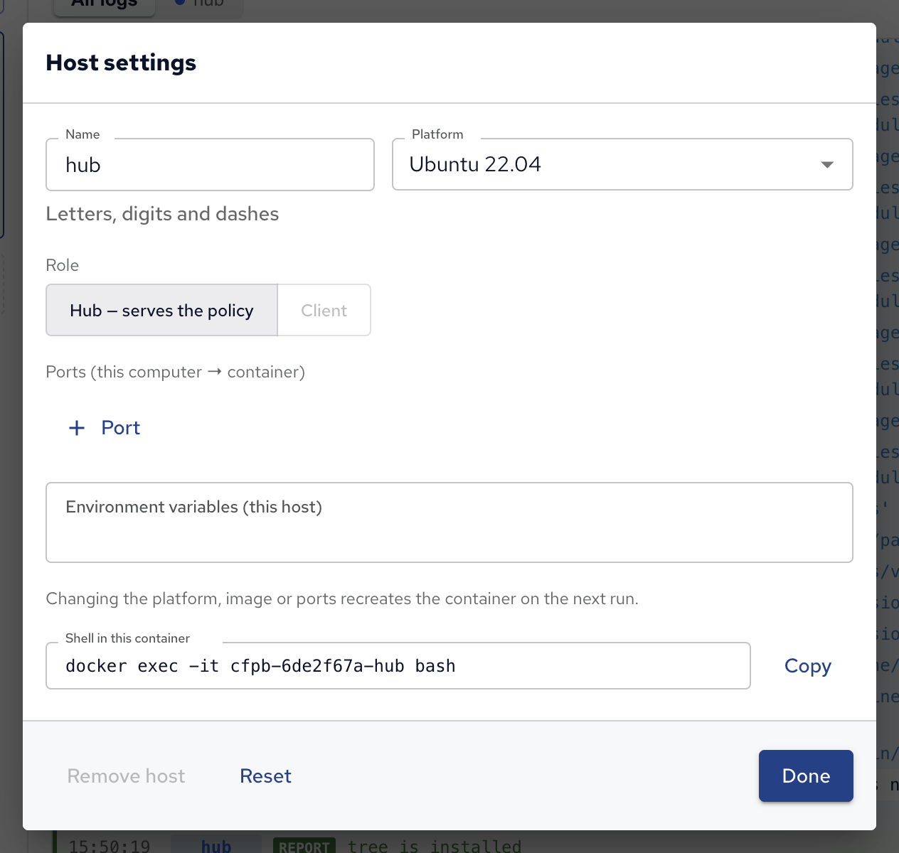

A test environment runs your policy on Docker containers on your own computer, before it reaches real hosts.
Each container is a host with real CFEngine installed: Policy Builder builds the policy set, deploys it to the environment's hub and runs the agent on every host, then shows what happened, block by block.

## Requirements

Test environments need Docker running on your computer: Docker Desktop, Colima, OrbStack or Docker Engine.
Policy Builder finds it on its own; while it looks, the view says **Checking Docker…**, and it tells you if Docker isn't installed or isn't running.

The first run downloads the platform's image and the CFEngine package, so it needs internet access and takes a few minutes. Later runs reuse them.

## Hosts

Open **Tests & Logs** (⌘3). A project without a test environment offers **Create test environment**, which adds one host that is also its own hub.

The environment's hosts are listed under **Topology nodes**:

- The **hub** host, marked **HUB**, is the policy server: it receives the policy set and the other hosts fetch it from there, as on a real CFEngine installation.
- **Add client host** adds a host that bootstraps to the hub: it registers with it, as a real host does when CFEngine is installed on it, and from then on fetches its policy there.
- **Add host** picks a host's platform: Ubuntu 20.04, 22.04 or 24.04, Debian 12 or 13, or RHEL 7, 8, 9 or 10. RHEL itself isn't freely available as an image, so those hosts run CentOS 7 and AlmaLinux 8 to 10, which are built from the same sources. **Add a host from another image** uses any Docker image, with the CFEngine package of the platform you choose.

Each host's gear icon opens its **Host settings**: its name, platform or image, its role (the hub, which serves the policy, or a client), environment variables, and ports published from your computer to the container, such as `localhost:8080` to the container's port 80 to look at a web server's page.
Changing the platform, image or ports recreates the container on the next run.

The settings icon at the top right opens the environment's settings:

| Setting                         | What it is                                                                  |
| ------------------------------- | --------------------------------------------------------------------------- |
| **Name**                        | The environment's name.                                                     |
| **Edition**                     | **Community** or **Enterprise** CFEngine.                                   |
| **CFEngine version**            | `latest`, or a version such as `3.27.1`.                                    |
| **Architecture**                | The hosts' processor architecture.                                          |
| **Agent runs per Deploy & run** | At most this many runs per host: runs repeat until one repairs nothing.     |
| **Environment variables**       | Variables set on all hosts.                                                 |
| **Secrets file (.env)**         | Optional. A file with variables kept out of the project, such as passwords. |

## Deploy and run

**Deploy & run** starts the hosts (creating and setting them up the first time), builds the policy set with masterfiles, deploys it to the hub and runs the agent on every host.
The play button on a host deploys and runs on that host only; **Stop** stops the containers but keeps what's installed on them.

The agent runs several times in a row, until a run repairs nothing: later runs settle what earlier ones changed.
A host's status then shows how it ended:

- **Converged**: the last run had nothing left to change. The policy is stable on this host.
- **Still repairing**: the last run still changed something, so some promise changes the host every time, such as a command that always runs or a file rewritten on every run. The host names the blocks to fix.
- **Failed**: the run didn't finish, for example because the hub refused the policy.

Test runs ignore How often, so every block runs every time.

## Logs and problems

The log on the right shows every host's output, or one host's with its tab. **Filter logs…** searches it.

Problems, such as promises not kept or policy errors, are listed above the log with the block they came from.
Click the block's name to show it on the canvas, where you can fix it, or the problem's link to find it in the log.
A problem that can't be traced to a block says **Not traced to a block**.

## Commands and shells

The bar under the log runs a command on all hosts or one, such as `/var/cfengine/bin/cf-agent -KI` to run the agent by hand, or `cat /etc/nginx/nginx.conf` to look at a file the policy wrote.
A host's terminal icon picks that host in the bar.

For an interactive shell, open a running host's settings with its gear icon: **Shell in this container** shows the `docker exec` command that opens one, to copy into a terminal.

**Purge all**, under the hosts, removes the environment's containers and their network. The environment's settings stay in the project, so the next run creates them again.
