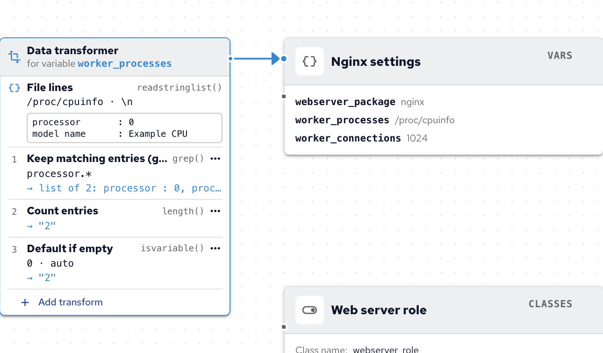
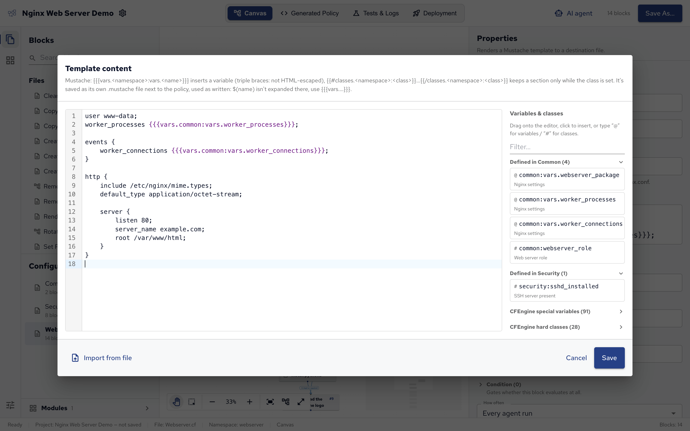

Blocks can take their values from variables instead of fixed text, so one change in one place updates every block that uses it.
This page explains variables and classes, where their values can come from, how to transform them, and how to render files from templates.

## Variables, lists and data

A _variable_ is a named value. CFEngine has a few kinds:

| Kind           | Holds                                 | Example             |
| -------------- | ------------------------------------- | ------------------- |
| String         | One piece of text                     | `nginx`             |
| List (`slist`) | Several pieces of text                | `{ "curl", "git" }` |
| Data           | Structured data, like a JSON document | `{ "port": 8080 }`  |

Variables are defined with a **Define Variable** block, and Policy Builder puts all of a configuration's variables in one bundle named `vars`.
That's why a block refers to a variable as `vars.` and its name:

- `$(vars.name)` for a variable defined in the same configuration.
- `$(common:vars.name)` for one defined in another configuration, here the one whose namespace is `common`: namespace, then `vars`, then the name.
- A list can be used where a block takes one value per line, such as **Package name**: the block then acts on each item.

Fields that take a variable or class name, such as a condition's **Trigger**, suggest names as you type, already written with the namespace they need.
See [Variables][] for how CFEngine handles them.

## Defining variables and classes

A **Define Variable** block holds one or more variable definitions, called entries; a **Define Class** block holds class definitions.
Add the block, then add entries in Properties: each one has a name, a source (where its value comes from) and, optionally, a condition.

Their variables and classes belong to the configuration they're in.
Put values several files share in one configuration of their own, as the demo does with **Common.cf**.

A variable entry can also be reported to CFEngine Enterprise's Inventory: turn on **Report variable** and give it an **Attribute name**, and Mission Portal's Inventory reports show its value for every host.

## Where a value comes from

An entry's source sets how its value is found on each host.
For example, a variable can be:

- typed in: **Literal**, **List**, or **Structured data (literal)**;
- different per host: **Per condition**, a value for each class expression, plus one for **Otherwise**;
- read from the host: **Command output**, **File content**, **File lines**, **File metadata**, **Environment variable** or **Structured data (JSON)** from a file;
- another variable: **Variable**, **List variable** or **Data variable**.

A class can be always true or false, combine other classes (**All of these classes (AND)**, **Any of these classes (OR)**), or test the host: a file or directory exists, a command succeeds, a value matches a pattern or compares with another.

The [Variable and class blocks][] reference lists every source with the CFEngine function it uses.

## Transforms

A value read from the host is often not quite what a block needs.
**Add transform** on an entry's value chains steps that change it, each one taking the result of the step before:

- **String transforms**, such as: extract or replace with a regular expression, trim, change case, take the first or last characters, format into a template, use a default if empty.
- **List transforms**, such as: split a string into a list, keep matching entries, sort, remove duplicates, remove entries, join into a string, pick an entry, count entries.
- **Data transforms**, such as: keys, values, a field, merge with JSON, as JSON text, count entries.

The demo counts the host's CPUs this way: the **File lines** of `/proc/cpuinfo`, then **Keep matching entries** `processor.*`, then **Count entries**, then **Default if empty** `auto`.
The canvas shows a variable's transforms as a card next to its block, with each step's result on sample data:



Each step must accept what the step before it produces: a list transform needs a list, so split a string into a list first.
**Preview transform** runs the steps on a sample input you type, so you can check the result before the policy runs.
Typed-in values (**Literal**, **List**, **Per condition** and **Structured data (literal)**) take no transforms.

A block's own setting can be computed the same way: under a setting that offers it, click **compute … from data…** to take its value from a source and transforms instead of typed-in text.

## Templates

A template is a file with placeholders that are filled in on each host, such as a configuration file with the right number of worker processes.
Policy Builder uses Mustache templates, CFEngine's built-in template language, with the **Render Template** block:

1. Add a **Render Template** block and set the **Destination path**, the file it writes on the host.
2. Click **Template content** to open the template editor.
3. Write the file, and insert variables and classes from the list next to the editor: drag them onto the editor, click them, or type `@` for variables and `#` for classes.



In a template, values are looked up by path, starting with `vars` for variables and `classes` for classes:

- A variable is inserted as `{{{vars.common:vars.worker_processes}}}`: `vars.`, then the variable's own reference, `common:vars.worker_processes` (namespace, the `vars` bundle, its name). The triple braces insert the value as it is.
- A class is a section, so its text appears only on hosts where the class is true. A hard class has no namespace, a class from the project has its configuration's:

```
{{#classes.debian}}
user www-data;
{{/classes.debian}}
{{#classes.common:webserver_role}}
# This host is a web server.
{{/classes.common:webserver_role}}
```

When saving, Policy Builder stores the templates in the project's `templates/` folder and ships them with the policy.
Connect a **Manage Service** block with a **repaired** arrow from the Render Template block to restart the service only when the file changed.
See [Rendering files with Mustache templates][] for the full template language.
